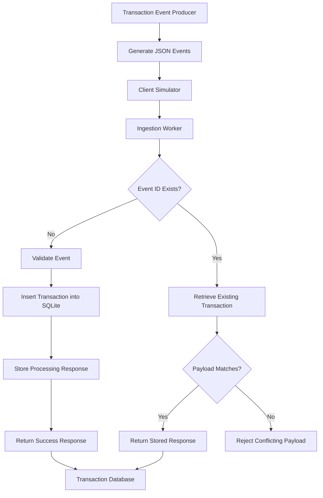
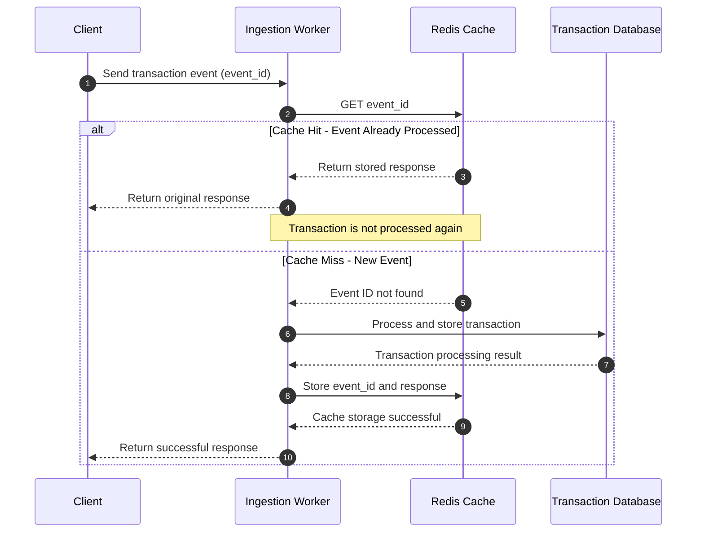

# Transaction Deduplication and Idempotent Data Ingestion Pipeline

## 1. Project Overview

This project demonstrates how to build a mock transaction data ingestion pipeline using Python and SQLite to handle duplicate messages caused by network delays and client-side retries.

In distributed data ingestion systems, transaction events may be delivered multiple times because of network failures, delayed responses, communication timeouts, or automatic retry mechanisms.

If an ingestion system processes every incoming message without checking whether it has already been processed, the same transaction may be inserted multiple times. This can result in duplicate records, incorrect financial calculations, and inconsistencies in downstream applications.

To address this problem, this project implements an **idempotent event processing mechanism** using SQLite's primary key constraint and stored processing responses.

The pipeline simulates transaction generation, ingestion, artificial network delays, client-side retries, duplicate detection, and transaction validation.

The primary objective is to demonstrate how a system can safely handle repeated transaction events without creating duplicate database records or modifying previously processed transaction data.

### Project Objectives

- Understand transaction event ingestion.
- Generate mock transaction events using Python.
- Implement a local transaction storage system using SQLite.
- Introduce artificial network delays.
- Simulate client-side timeouts and automatic retries.
- Reproduce duplicate message delivery.
- Implement deduplication using unique event IDs.
- Return previously stored responses for duplicate events.
- Reject conflicting transaction payloads.
- Verify idempotency through automated testing.
- Understand at-least-once and at-most-once delivery semantics.

---

## 2. Problem Statement

Consider an e-commerce or banking application where a customer makes a payment of ₹3,000.

The application sends a transaction event to the ingestion system.

The ingestion worker successfully processes the transaction and saves it in the database. However, the response is delayed because of a network problem.

The client assumes that the transaction failed because it did not receive a response within the expected time.

Consequently, the client sends the same transaction again.

If the ingestion system does not implement deduplication, it may process the same transaction multiple times.

### Example Scenario

| Attempt         | Event ID | Amount | Scenario                                       |
| --------------- | -------- | -----: | ---------------------------------------------- |
| First request   | TXN004   | ₹3,000 | Transaction processed successfully             |
| Server response | TXN004   | ₹3,000 | Response delayed by network                    |
| Second request  | TXN004   | ₹3,000 | Client retries after timeout                   |
| Worker response | TXN004   | ₹3,000 | Duplicate detected; original response returned |

**Problem:** The same transaction must not be inserted into the database more than once.

**Solution:** Implement an idempotent ingestion mechanism that identifies previously processed events using a unique event ID.

---

## 3. Technologies and Tools Used

| Technology / Tool | Purpose                                     |
| ----------------- | ------------------------------------------- |
| Python 3.14.3     | Main programming language                   |
| SQLite            | Lightweight relational database             |
| sqlite3           | Python database connectivity                |
| JSON              | Transaction event data exchange             |
| datetime          | Transaction timestamps                      |
| time              | Artificial network delays                   |
| unittest          | Automated testing                           |
| tempfile          | Temporary databases for isolated tests      |
| unittest.mock     | Mocking database configuration during tests |
| VS Code           | Development environment                     |
| Git               | Version control                             |
| GitHub            | Source code repository                      |
| Mermaid           | Architecture and sequence diagrams          |

**Important:** This implementation uses SQLite as a local deduplication store. Redis is included in the conceptual distributed architecture diagram to illustrate how a production ingestion worker could use a distributed cache.

No Redis server or external messaging framework is required to execute this project.

---

## 4. Important Concepts Explained

### 4.1 Data Ingestion

Data ingestion is the process of collecting data from different sources and transferring it into a storage system or data processing environment.

In this project, the producer generates transaction events and sends them to the ingestion worker.

### 4.2 Transaction Event

A transaction event is a structured representation of a transaction.

Example:

```json
{
  "event_id": "TXN001",
  "customer_id": "CUST101",
  "amount": 1000.0,
  "currency": "INR",
  "created_at": "2026-11-16T10:41:34+00:00"
}
```

Each transaction contains a unique event identifier.

### 4.3 Event ID

An event ID is a unique identifier assigned to an individual event.

Examples:

- TXN001
- TXN002
- TXN003
- TXN004

The event ID helps the ingestion worker identify whether an incoming event has already been processed.

### 4.4 Network Delay

Network delay is the time taken for data or a response to travel between communicating systems.

In this project, artificial delays are introduced using Python's `time.sleep()` function.

This simulates situations where the server response arrives later than the client's expected timeout.

### 4.5 Client-Side Retry

A client-side retry occurs when a client sends the same request again because it assumes the previous request failed.

For example:

1. Client sends TXN004.
2. Server processes TXN004.
3. Server response is delayed.
4. Client experiences a timeout.
5. Client sends TXN004 again.

The second request creates the possibility of duplicate processing.

### 4.6 Deduplication

Deduplication is the process of identifying and preventing repeated records or events from being processed as new events.

In this project, SQLite uses the `event_id` primary key to prevent duplicate transaction insertion.

### 4.7 Idempotency

Idempotency means that performing the same operation multiple times produces the same final effect as performing it once.

For example:

If TXN004 is submitted ten times, the database should still contain only one transaction record for TXN004.

The ingestion worker returns the previously stored response instead of processing the transaction again.

### 4.8 Primary Key Constraint

A primary key uniquely identifies each record in a database table.

This project uses:

```sql
event_id TEXT PRIMARY KEY
```

This prevents two transaction records from having the same event ID.

### 4.9 Stored Response

The original processing response is stored in the database as JSON.

When a duplicate event arrives, the worker retrieves and returns the original response.

This ensures that repeated requests receive a consistent result.

### 4.10 Conflicting Payload

A conflicting payload occurs when an event arrives with an existing event ID but different transaction details.

Example:

Original transaction:

```json
{
  "event_id": "TXN004",
  "customer_id": "CUST104",
  "amount": 3000,
  "currency": "INR"
}
```

Conflicting retry:

```json
{
  "event_id": "TXN004",
  "customer_id": "CUST104",
  "amount": 9000,
  "currency": "INR"
}
```

The event ID is identical, but the amount is different.

The worker rejects this request instead of returning a misleading successful response or modifying the original transaction.

---

## 5. Project Architecture

The project consists of four main application components.

### 5.1 Transaction Producer

The producer generates mock transaction events.

It creates transaction details such as:

- Event ID
- Customer ID
- Transaction amount
- Currency
- Creation timestamp

File:

`src/producer/event_producer.py`

### 5.2 Ingestion Worker

The ingestion worker receives transaction events and processes them.

Responsibilities:

- Receive incoming events.
- Attempt to insert the transaction into SQLite.
- Check whether the event ID already exists.
- Return the original stored response for valid duplicates.
- Reject conflicting transaction payloads.
- Preserve transaction data integrity.

File:

`src/worker/ingestion_worker.py`

### 5.3 SQLite Database

SQLite stores the processed transaction records.

The transactions table contains:

| Column        | Description                         |
| ------------- | ----------------------------------- |
| event_id      | Unique transaction event identifier |
| customer_id   | Customer identifier                 |
| amount        | Transaction amount                  |
| currency      | Transaction currency                |
| status        | Processing status                   |
| created_at    | Original event creation timestamp   |
| processed_at  | Event processing timestamp          |
| response_json | Stored processing response          |

The `event_id` column is configured as the primary key.

File:

`src/database/db.py`

### 5.4 Client Simulator

The client simulator sends transaction events to the ingestion worker.

It introduces artificial network delays and simulates client-side timeouts.

When a response takes longer than the configured timeout, the client retries the transaction.

File:

`src/client/client_simulator.py`

---

## 6. Complete Project Folder Structure

```text
transaction-deduplication-assignment/
│
├── .venv/
│
├── src/
│   │
│   ├── database/
│   │   ├── db.py
│   │   └── validate_database.py
│   │
│   ├── producer/
│   │   └── event_producer.py
│   │
│   ├── worker/
│   │   └── ingestion_worker.py
│   │
│   └── client/
│       ├── client_simulator.py
│       └── duplicate_test.py
│
├── tests/
│   └── test_idempotency.py
│
├── data/
│   └── transactions.db
│
├── logs/
│
├── .gitignore
│
└── README.md
```

### Folder Responsibilities

| Directory / File | Responsibility                          |
| ---------------- | --------------------------------------- |
| `src/`           | Contains the main application code      |
| `src/database/`  | Database initialization and validation  |
| `src/producer/`  | Transaction event generation            |
| `src/worker/`    | Transaction ingestion and deduplication |
| `src/client/`    | Retry simulation and duplicate testing  |
| `tests/`         | Automated idempotency tests             |
| `data/`          | Local SQLite database storage           |
| `logs/`          | Reserved for application logs           |
| `.venv/`         | Python virtual environment              |
| `.gitignore`     | Excludes unnecessary files from Git     |
| `README.md`      | Project documentation                   |

---

## 7. Implementation: Step-by-Step Workflow

### Step 1: Environment Setup

Created a dedicated project directory and configured the Python development environment.

Project directory:

```text
D:\transaction-deduplication-assignment
```

Verified the installed tools:

```text
Python 3.14.3
Git 2.53.0.windows.1
pip 26.0.1
```

Created and activated the virtual environment:

```powershell
python -m venv .venv
```

```powershell
.venv\Scripts\activate
```

No external Python packages were required because the implementation uses Python's standard library.

### Step 2: Project Structure Creation

Created separate directories for:

- Database management
- Event production
- Transaction processing
- Client simulation
- Automated testing
- Local database storage

This separation makes the application easier to maintain and extend.

### Step 3: SQLite Database Initialization

Created the database initialization module:

`src/database/db.py`

Implemented:

- SQLite connection management.
- Database path configuration.
- Transactions table creation.
- Primary key constraint on event IDs.
- Database connection cleanup.

Created the transactions table using SQL:

```sql
CREATE TABLE IF NOT EXISTS transactions (
    event_id TEXT PRIMARY KEY,
    customer_id TEXT NOT NULL,
    amount REAL NOT NULL,
    currency TEXT NOT NULL,
    status TEXT NOT NULL,
    created_at TEXT NOT NULL,
    processed_at TEXT NOT NULL,
    response_json TEXT
);
```

Executed:

```powershell
python src/database/db.py
```

Verified that the table contained all eight expected columns and that `event_id` was configured as the primary key.

### Step 4: Transaction Event Producer

Created:

`src/producer/event_producer.py`

Implemented a Python function that generates three mock transaction events.

Generated transactions:

| Event ID | Customer ID | Amount | Currency |
| -------- | ----------- | -----: | -------- |
| TXN001   | CUST101     | ₹1,000 | INR      |
| TXN002   | CUST102     | ₹2,500 | INR      |
| TXN003   | CUST103     |   ₹500 | INR      |

Executed:

```powershell
python src\producer\event_producer.py
```

Verified that three transaction events were generated successfully in JSON format.

### Step 5: Ingestion Worker Implementation

Created:

`src/worker/ingestion_worker.py`

Implemented the `process_event()` function.

The worker:

1. Receives a transaction event.
2. Establishes a database connection.
3. Attempts to insert the transaction.
4. Checks whether the event was inserted.
5. Retrieves the original response if the event already exists.
6. Validates repeated transaction details.
7. Rejects conflicting payloads.
8. Returns the appropriate processing response.

The main deduplication operation uses:

```sql
INSERT OR IGNORE INTO transactions (...)
VALUES (?, ?, ?, ?, ?, ?, ?, ?);
```

If a new event is inserted, the worker returns a successful processing response.

If the event ID already exists, the worker retrieves the existing record and its stored response.

For conflicting transaction details, the worker raises a `ValueError`.

Executed:

```powershell
python -m src.worker.ingestion_worker
```

Verified that all three initial transaction events were successfully processed.

### Step 6: Artificial Network Delays and Client-Side Retries

Created:

`src/client/client_simulator.py`

Implemented a mock client that sends a transaction to the ingestion worker.

Configured:

| Parameter                 |       Value |
| ------------------------- | ----------: |
| Client timeout            |    1 second |
| Maximum retries           |           3 |
| First response delay      |   2 seconds |
| Subsequent response delay | 0.2 seconds |

The first transaction used:

```text
Event ID: TXN004
Customer ID: CUST104
Amount: ₹3,000
Currency: INR
```

Simulation workflow:

1. Client sends TXN004.
2. Worker processes and stores TXN004.
3. Artificial network delay of two seconds is introduced.
4. Client detects that the response exceeded its one-second timeout.
5. Client retries TXN004.
6. Worker identifies the existing event ID.
7. Worker returns the previously stored response.

Executed:

```powershell
python -m src.client.client_simulator
```

**Observed result:**

```text
Sending event: TXN004
Attempt: 1

NEW EVENT PROCESSED: TXN004

CLIENT TIMEOUT: Response arrived too late.
Retrying transaction...

Sending event: TXN004
Attempt: 2

DUPLICATE EVENT DETECTED: TXN004

CLIENT SUCCESS: Response received.
```

The transaction was stored only once despite the repeated request.

Note: This is a synchronous delay simulation. The timeout is detected after the worker returns and the artificial response delay completes. It does not implement a real asynchronous network timeout.

### Step 7: Repeated Duplicate Event Testing

Created:

`src/client/duplicate_test.py`

Implemented a test that sends the same transaction event ten times.

The test verifies:

- Repeated event submissions.
- Duplicate detection.
- Stored response consistency.
- Database record count.

Executed:

```powershell
python -m src.client.duplicate_test
```

Observed result:

```text
Total requests: 10
Database records for TXN004: 1
All responses identical: True

SUCCESS: Idempotency verified!
```

This demonstrates that ten repeated requests do not create ten transaction records.

### Step 8: Automated Testing

Created:

`tests/test_idempotency.py`

Used Python's built-in `unittest` framework.

Implemented six automated test cases.

| Test Case                           | Purpose                                                         |
| ----------------------------------- | --------------------------------------------------------------- |
| `test_new_event_processing`         | Verifies successful processing of a new event                   |
| `test_duplicate_event_processing`   | Verifies that duplicate events return the original response     |
| `test_multiple_duplicate_requests`  | Verifies that ten repeated requests create only one record      |
| `test_different_events`             | Verifies that different event IDs create separate records       |
| `test_transaction_amount_integrity` | Verifies that the original transaction amount remains unchanged |
| `test_conflicting_payload_rejected` | Verifies that a conflicting transaction payload is rejected     |

The tests use temporary SQLite databases so they do not modify the main project database.

Executed:

```powershell
python -m unittest discover -s tests -v
```

**Final test result:**

```text
Ran 6 tests

OK
```

All six automated tests passed successfully.

### Step 9: Conflicting Payload Validation

Improved the ingestion worker to handle situations where the same event ID is received with different transaction details.

Example:

Original transaction:

```text
Event ID: TEST007
Amount: ₹3,000
```

Conflicting request:

```text
Event ID: TEST007
Amount: ₹9,000
```

The worker rejects the conflicting request instead of overwriting the original transaction.

The automated test confirms that:

- The conflicting request raises a `ValueError`.
- Only one transaction record exists.
- The original amount remains ₹3,000.

### Step 10: Final Database Validation

Created:

`src/database/validate_database.py`

Implemented database validation queries to verify:

- Total transaction count.
- Number of unique event IDs.
- Total transaction amount.
- Duplicate event IDs.
- Transaction status distribution.
- SQLite database integrity.
- Final transaction records.

Executed:

```powershell
python -m src.database.validate_database
```

The final validation completed successfully.

---

## 8. Architecture Diagram

The following diagram illustrates the implemented local transaction ingestion pipeline.



### Architecture Explanation

The producer generates transaction events in JSON format.

The client simulator sends the events to the ingestion worker.

The worker checks whether the event ID already exists in the SQLite database.

If the event is new, the worker inserts the transaction and stores its processing response.

If the event already exists, the worker compares the incoming transaction details with the existing record.

If the payload matches, the original response is returned.

If the payload differs, the conflicting request is rejected.

This approach prevents duplicate transaction insertion and protects existing transaction data.

---

## 9. Distributed Deduplication Cache: Redis Sequence Diagram

The assignment also requires a sequential sequence diagram illustrating how an ingestion worker checks an incoming event ID against a distributed deduplication cache such as Redis.

The following diagram represents the conceptual Redis-based architecture.

**Note:** Redis is shown as a proposed distributed architecture. The implemented project uses SQLite instead.



### Sequence Diagram Explanation

**Cache Hit Path:**

1. The client sends a transaction event.
2. The ingestion worker checks the event ID in Redis.
3. Redis finds an existing event ID.
4. Redis returns the previously stored response.
5. The worker returns the original response to the client.
6. The transaction is not processed again.

**Cache Miss Path:**

1. The client sends a new transaction event.
2. The ingestion worker checks Redis.
3. Redis does not find the event ID.
4. The worker processes and stores the transaction in the database.
5. The worker stores the event ID and processing response in Redis.
6. The worker returns the successful response to the client.

### Production Considerations

A production Redis implementation should also consider:

- Atomic reservation of event IDs.
- Concurrent duplicate requests.
- Cache expiration and retention policies.
- Database and cache consistency.
- Recovery when cache writes fail.
- Durable database constraints as a final safeguard.

A simple Redis GET followed by SET is not sufficient to guarantee exactly-once effects under concurrent requests. Atomic operations or another concurrency-control mechanism are needed.

---

## 10. At-Least-Once vs At-Most-Once Delivery Semantics

### At-Least-Once Delivery

At-least-once delivery ensures that a message is delivered one or more times until successful acknowledgement or completion.

If a client does not receive a response, it may retry the same message.

This reduces the risk of losing messages but introduces the possibility of duplicate delivery.

For example, a payment transaction may be successfully processed by the server, but a delayed response can cause the client to submit the same payment event again.

Therefore, idempotent processing is important when using at-least-once delivery.

### At-Most-Once Delivery

At-most-once delivery ensures that a message is delivered zero or one time.

The system does not repeatedly retry an unacknowledged message.

This avoids repeated delivery attempts but introduces the possibility of message loss if a failure occurs before successful processing.

### Comparison

| Parameter             | At-Least-Once           | At-Most-Once         |
| --------------------- | ----------------------- | -------------------- |
| Delivery count        | One or more times       | Zero or one time     |
| Retry mechanism       | Commonly used           | Generally not used   |
| Duplicate possibility | Yes                     | No repeated delivery |
| Message loss          | Reduced, not eliminated | Possible             |
| Idempotency           | Important               | Still useful         |

### Summary

At-least-once and at-most-once are two important message delivery semantics used in data ingestion systems. At-least-once delivery guarantees that a message will be delivered one or more times, usually through retries until successful acknowledgement. However, network failures, delayed responses, and client timeouts can cause the same event to be delivered multiple times. This creates a risk of duplicate database records, repeated payments, and incorrect downstream calculations.

At-most-once delivery attempts to deliver a message zero or one time. It avoids repeated delivery attempts but may lose messages when failures occur before successful processing or acknowledgement.

Retries are useful for improving reliability, but they require an idempotent architecture. Idempotency ensures that processing the same event multiple times produces the same final effect as processing it once. This can be achieved by assigning unique event IDs, enforcing database uniqueness constraints, and storing previous processing responses.

In this project, SQLite uses an event ID primary key to prevent duplicate transaction insertion. The ingestion worker retrieves the original response for identical repeated events and rejects conflicting transaction payloads. Therefore, even when client retries occur, the database maintains consistent transaction records.

---

## 11. Final Implementation Results

The following results were obtained from the completed project execution.

### 11.1 Transaction Records

| Event ID | Customer ID | Amount | Status    |
| -------- | ----------- | -----: | --------- |
| TXN001   | CUST101     | ₹1,000 | PROCESSED |
| TXN002   | CUST102     | ₹2,500 | PROCESSED |
| TXN003   | CUST103     |   ₹500 | PROCESSED |
| TXN004   | CUST104     | ₹3,000 | PROCESSED |

### 11.2 Database Validation Results

| Validation Metric        | Result |
| ------------------------ | -----: |
| Total Transactions       |      4 |
| Unique Event IDs         |      4 |
| Total Transaction Amount | ₹7,000 |
| Duplicate Event IDs      |      0 |
| Processed Transactions   |      4 |
| SQLite Integrity         |     OK |
| Final Validation         | PASSED |

### 11.3 Automated Testing Results

| Test Case                       | Result |
| ------------------------------- | ------ |
| New event processing            | PASSED |
| Duplicate event processing      | PASSED |
| Ten repeated duplicate requests | PASSED |
| Different event IDs             | PASSED |
| Transaction amount integrity    | PASSED |
| Conflicting payload rejection   | PASSED |

**Total automated tests: 6**

**Passed: 6**

**Failed: 0**

### 11.4 Retry Simulation Results

| Parameter                         | Result                             |
| --------------------------------- | ---------------------------------- |
| Event ID                          | TXN004                             |
| First attempt                     | Successfully processed             |
| Artificial response delay         | 2 seconds                          |
| Client timeout                    | 1 second                           |
| Retry attempt                     | Successfully detected as duplicate |
| Final database records for TXN004 | 1                                  |
| Original response returned        | Yes                                |

---

## 12. Limitations

Although the project demonstrates the core concepts of duplicate event handling and idempotent processing, it has some limitations.

1. **Local Database:** SQLite is used instead of a distributed database or Redis cache.

2. **Mock Network Simulation:** Network delays are simulated using Python's `time.sleep()` rather than actual network communication.

3. **Synchronous Execution:** The client waits for the worker and then evaluates the elapsed time. This is not a true asynchronous network timeout.

4. **No Messaging Broker:** Kafka, RabbitMQ, and other messaging frameworks are not implemented.

5. **No Distributed Workers:** The project uses a single local ingestion worker rather than multiple distributed workers.

6. **No Production Deployment:** The pipeline runs locally and does not include cloud infrastructure or production monitoring.

7. **Cache Consistency:** A distributed Redis cache implementation and its failure-recovery mechanisms are represented conceptually rather than implemented.

---

## 13. Future Improvements

The project can be extended in several ways:

- Integrate Redis for distributed deduplication.
- Introduce Apache Kafka or RabbitMQ for event streaming.
- Implement asynchronous event processing.
- Use atomic idempotency-key reservation.
- Implement concurrent worker processing.
- Add structured application logging.
- Introduce retry backoff strategies.
- Implement dead-letter queues for failed events.
- Add Docker containerization.
- Deploy the ingestion pipeline to a cloud environment.
- Implement monitoring and performance benchmarking.

These improvements would help transform the local demonstration into a more production-oriented event ingestion architecture.

---

## 14. How to Run the Project

### Prerequisites

- Python 3.14.3 or a compatible Python version.
- Git.
- Visual Studio Code (optional).

No external Python dependencies are required.

### Step 1: Clone the Repository

```bash
git clone https://github.com/Ashu11122000/transaction-deduplication.git
```

Navigate to the project directory:

```bash
cd transaction-deduplication-assignment
```

### Step 2: Create a Virtual Environment

```powershell
python -m venv .venv
```

Activate it:

```powershell
.venv\Scripts\activate
```

### Step 3: Initialize the Database

```powershell
python src/database/db.py
```

### Step 4: Generate Transaction Events

```powershell
python src/producer/event_producer.py
```

### Step 5: Run the Ingestion Worker

```powershell
python -m src.worker.ingestion_worker
```

### Step 6: Simulate Network Delays and Retries

```powershell
python -m src.client.client_simulator
```

### Step 7: Test Repeated Duplicate Messages

```powershell
python -m src.client.duplicate_test
```

### Step 8: Run Automated Tests

```powershell
python -m unittest discover -s tests -v
```

### Step 9: Validate the Database

```powershell
python -m src.database.validate_database
```

---

## 15. Key Learnings

Through this hands-on assignment, the following concepts were explored and implemented:

- Understanding event-driven data ingestion.
- Generating structured transaction events.
- Working with JSON data.
- Creating and managing SQLite databases.
- Implementing unique constraints and primary keys.
- Understanding duplicate message delivery.
- Simulating network delays and client-side retries.
- Implementing idempotent event processing.
- Returning previously stored processing responses.
- Detecting conflicting transaction payloads.
- Writing automated tests using Python unittest.
- Validating transaction data integrity.
- Understanding at-least-once and at-most-once delivery semantics.
- Understanding the role of Redis in distributed deduplication architectures.

---

## 16. Conclusion

This project successfully demonstrates how duplicate transaction events can occur in data ingestion pipelines because of network delays, timeouts, and client-side retries.

A Python-based transaction producer, ingestion worker, client simulator, and SQLite database were implemented to reproduce and handle this scenario.

The deduplication mechanism uses unique event IDs, SQLite primary key constraints, stored processing responses, and payload validation to prevent repeated transaction insertion and protect existing transaction data.

The implementation was validated through repeated duplicate requests, artificial network delay simulations, six automated test cases, and final database integrity checks.

All six automated tests passed, four unique transactions were stored, and no duplicate event IDs were found.

The project also demonstrates the importance of idempotent architectures when working with at-least-once message delivery and provides a conceptual Redis-based sequence diagram for understanding distributed deduplication.

**Final Outcome:** Successfully implemented and tested a local idempotent transaction ingestion pipeline that prevents duplicate database records during simulated client retries.

---

## 17. Project Information

| Attribute                 | Details                                                          |
| ------------------------- | ---------------------------------------------------------------- |
| Project                   | Transaction Deduplication and Idempotent Data Ingestion Pipeline |
| Type                      | Hands-on Data Engineering Assignment                             |
| Language                  | Python                                                           |
| Database                  | SQLite                                                           |
| Testing Framework         | unittest                                                         |
| Architecture              | Event-driven ingestion simulation                                |
| Deduplication Strategy    | Unique Event ID + Stored Response                                |
| Final Automated Tests     | 6 Passed                                                         |
| Final Database Validation | PASSED                                                           |
| Implementation Status     | Completed                                                        |

**End of Documentation**
